# Entrega 3 - Despliegue manual inicial en ECS/Fargate

Responsable: Jose Miguel Pardo Diaz (Integrante 2) · Equipo CodeBusters

Esta guía deja el microservicio `blacklists` corriendo en ECS/Fargate detrás de un ALB, con RDS PostgreSQL, listo para que el pipeline de CD (CodeBuild + CodeDeploy) lo actualice con Blue/Green.

Cada integrante la ejecuta **en su propia cuenta**, cambiando solo los parámetros de la sección 2.

> Estado de validación (10 nov 2026): las secciones **2 a 12** se ejecutaron con éxito en la cuenta del Integrante 2, desde AWS CloudShell, incluida la colección Postman contra el ALB (7 de 7 pruebas). Falta ejecutar completa la limpieza de la sección **14**; de ella solo se probó el borrado de RDS.
>
> Cada sección termina con capturas de referencia de esa ejecución. El ID de cuenta está oculto en todas y ninguna muestra secretos ni tokens.

---

## 1. Alcance y decisiones

| Tema | Decisión |
| --- | --- |
| Herramienta | AWS CLI v2, desde AWS CloudShell o desde la máquina local (bash o zsh). Evita diferencias entre consolas y hace el procedimiento repetible |
| Red | VPC por defecto, dos subnets públicas (`us-east-1a` y `us-east-1b`) |
| Salida de las tareas a ECR, logs y secretos | Tarea con **IP pública** en subnet pública. Sin NAT Gateway ni VPC endpoints, que cobran por hora en cada cuenta |
| Entrada a las tareas | Solo desde el security group del ALB, puerto 5000. La IP pública no queda expuesta |
| Entrada a RDS | Solo desde el security group de las tareas, puerto 5432. RDS sin acceso público |
| Secretos | SSM Parameter Store, tipo `SecureString`. No tiene costo, a diferencia de Secrets Manager |
| Roles | Se crea un rol de ejecución propio. No se depende de roles preexistentes en la cuenta |
| Rol de tarea | No se crea: la aplicación no llama a servicios de AWS |
| Tablas | Tarea puntual con `flask init-db`. No se ejecuta en cada arranque |
| Listener | Solo producción en el puerto 80. CodeDeploy no exige listener de pruebas |

### Frontera con los demás componentes

| Quién | Qué crea |
| --- | --- |
| Esta guía (despliegue manual) | Security groups, rol de ejecución, parámetros SSM, RDS, repositorio ECR e imagen inicial, ALB, listener de producción, dos target groups, cluster, task definition inicial, servicio ECS con controlador `CODE_DEPLOY` |
| Fabio (CodeBuild/ECR) | Proyecto CodeBuild, su rol, `taskdef.json` generado desde la plantilla |
| Juan David (Pipeline/CodeDeploy) | Rol de CodeDeploy, aplicación y grupo de despliegue, CodePipeline y conexión GitHub |

La sección 12 lista los valores exactos que esta guía entrega a Fabio y a Juan David.

Las `.ebextensions` de Beanstalk **no se ejecutan en Fargate**. Todo lo que hacían (variables de proxy, `init-db`) queda explícito en esta guía.

---

## 2. Requisitos y parámetros

### 2.1 Requisitos

- AWS CLI v2 contra la **cuenta personal**, con permisos de administrador. La opción más simple es **AWS CloudShell** en `us-east-1`: ya trae el CLI autenticado con la sesión de la consola y su directorio personal persiste entre sesiones.
- Docker, solo para la sección 7 (construir y subir la imagen). CloudShell ya lo trae; en la máquina local se necesita Docker Desktop.
- Repositorio clonado y ubicado en `main`, con el `Dockerfile` de Oscar ya integrado.
- `openssl` (viene en macOS y Linux).

Comprobar la cuenta antes de crear nada:

```bash
aws sts get-caller-identity --query Account --output text
```

### 2.2 Parámetros que cambia cada integrante

Lo único que cambia entre cuentas es el número de integrante:

```bash
export IDX=2                      # 1 Oscar, 2 Jose Miguel, 3 Fabio, 4 Juan David
```

El resto se deriva y es igual para todos:

```bash
export AWS_REGION=us-east-1
export AWS_DEFAULT_REGION=us-east-1
export AWS_PAGER=""
export PREFIX=cb-e3-i${IDX}
export ACCOUNT_ID=$(aws sts get-caller-identity --query Account --output text)

export CONTAINER_NAME=blacklists
export CONTAINER_PORT=5000
export ECR_REPO=${PREFIX}-blacklists
export ECR_URI=${ACCOUNT_ID}.dkr.ecr.${AWS_REGION}.amazonaws.com/${ECR_REPO}
export CLUSTER=${PREFIX}-cluster
export SERVICE=${PREFIX}-service
export TASK_FAMILY=${PREFIX}-blacklists
export EXEC_ROLE=${PREFIX}-ecs-exec-role
export LOG_GROUP=/ecs/${PREFIX}-blacklists
export DB_ID=${PREFIX}-db
```

> Las variables viven solo en la terminal abierta. Para no perderlas, guardar los dos bloques anteriores en un archivo y cargarlo en cada sesión nueva:
>
> ```bash
> source ~/e3-env.sh
> ```
>
> Después, el **Anexo A** recupera los identificadores de los recursos ya creados.

Para comprobar la cuenta sin exponer el ID en las capturas:

```bash
echo "Cuenta: ********${ACCOUNT_ID: -4} | Region: $AWS_REGION | Prefijo: $PREFIX"
```

### Capturas de referencia

Ejemplo de la cuenta del Integrante 2. Los identificadores son de esa cuenta: no copiarlos.

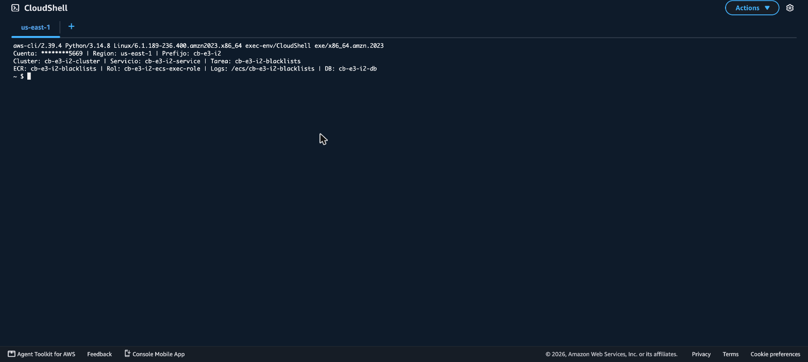

*Figura S2-01. Parámetros cargados en CloudShell; la cuenta se muestra solo con sus últimos cuatro dígitos.*

---

## 3. Red y security groups

```bash
export VPC_ID=$(aws ec2 describe-vpcs --filters Name=is-default,Values=true \
  --query 'Vpcs[0].VpcId' --output text)

export SUBNET_A=$(aws ec2 describe-subnets \
  --filters Name=vpc-id,Values=$VPC_ID Name=availability-zone,Values=us-east-1a \
  --query 'Subnets[0].SubnetId' --output text)

export SUBNET_B=$(aws ec2 describe-subnets \
  --filters Name=vpc-id,Values=$VPC_ID Name=availability-zone,Values=us-east-1b \
  --query 'Subnets[0].SubnetId' --output text)

echo $VPC_ID $SUBNET_A $SUBNET_B
```

Los tres valores deben verse con formato `vpc-...` y `subnet-...`. Si `VPC_ID` sale `None`, la cuenta no tiene VPC por defecto: crearla con `aws ec2 create-default-vpc` y repetir.

Security groups:

```bash
export ALB_SG=$(aws ec2 create-security-group --group-name ${PREFIX}-alb-sg \
  --description "ALB publico Entrega 3" --vpc-id $VPC_ID \
  --query GroupId --output text)

export TASK_SG=$(aws ec2 create-security-group --group-name ${PREFIX}-task-sg \
  --description "Tareas Fargate Entrega 3" --vpc-id $VPC_ID \
  --query GroupId --output text)

export RDS_SG=$(aws ec2 create-security-group --group-name ${PREFIX}-rds-sg \
  --description "RDS Entrega 3" --vpc-id $VPC_ID \
  --query GroupId --output text)

# Internet -> ALB en 80
aws ec2 authorize-security-group-ingress --group-id $ALB_SG \
  --protocol tcp --port 80 --cidr 0.0.0.0/0 > /dev/null

# ALB -> tareas en 5000
aws ec2 authorize-security-group-ingress --group-id $TASK_SG \
  --protocol tcp --port $CONTAINER_PORT --source-group $ALB_SG > /dev/null

# Tareas -> RDS en 5432
aws ec2 authorize-security-group-ingress --group-id $RDS_SG \
  --protocol tcp --port 5432 --source-group $TASK_SG > /dev/null
```

La salida de `authorize-security-group-ingress` se descarta porque incluye el ID de cuenta. Para ver las reglas creadas:

```bash
aws ec2 describe-security-group-rules \
  --filters Name=group-id,Values=$ALB_SG,$TASK_SG,$RDS_SG \
  --query 'SecurityGroupRules[?!IsEgress].[GroupId,IpProtocol,FromPort,CidrIpv4,ReferencedGroupInfo.GroupId]' \
  --output table
```

Antes de crear los grupos conviene comprobar que no existan ya, para no duplicarlos: `aws ec2 describe-security-groups --filters Name=group-name,Values="${PREFIX}-*" --query 'SecurityGroups[].GroupName' --output text` debe salir vacío.

La salida de las tareas queda con la regla por defecto (todo permitido). Es lo que usan las tareas para llegar a ECR, CloudWatch Logs y SSM.

Evidencia: Reglas de entrada de `${PREFIX}-task-sg` y `${PREFIX}-rds-sg`.

### Capturas de referencia

Ejemplo de la cuenta del Integrante 2. Los identificadores son de esa cuenta: no copiarlos.

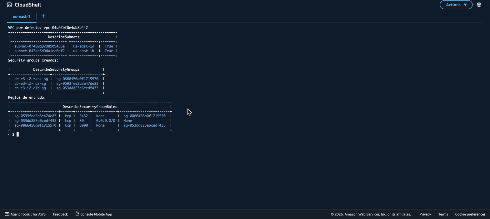

*Figura S3-01. VPC por defecto, subnets públicas, security groups creados y sus reglas de entrada.*

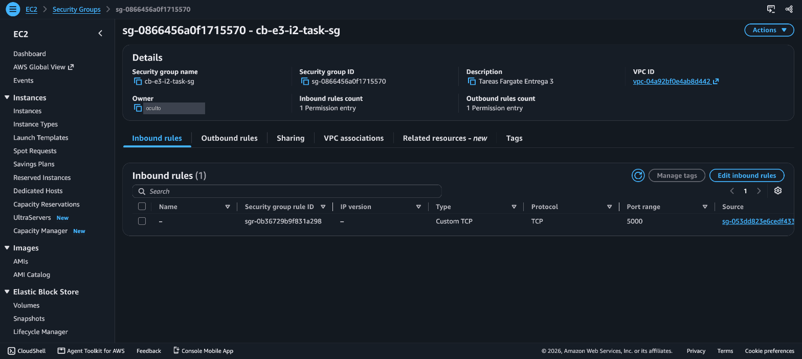

*Figura S3-02. Security group de las tareas: entrada TCP 5000 solo desde el grupo del ALB.*

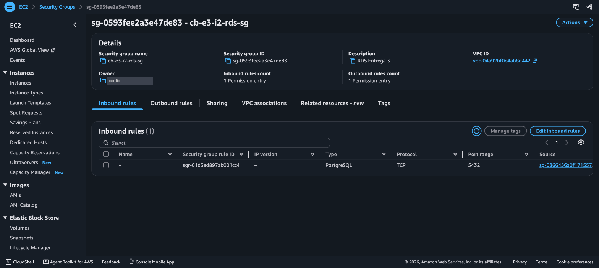

*Figura S3-03. Security group de RDS: entrada PostgreSQL 5432 solo desde el grupo de las tareas.*

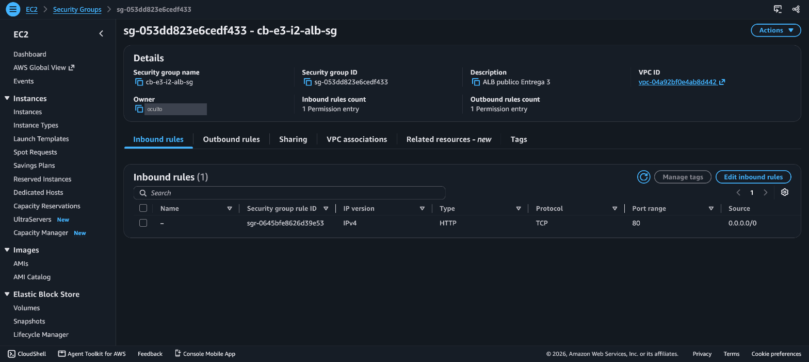

*Figura S3-04. Security group del ALB: entrada HTTP 80 desde internet.*

---

## 4. Rol de ejecución y grupo de logs

El rol de ejecución lo usa ECS (no la aplicación) para bajar la imagen, escribir logs y leer los parámetros SSM.

```bash
cat > /tmp/trust.json <<JSON
{"Version":"2012-10-17","Statement":[{"Effect":"Allow","Principal":{"Service":"ecs-tasks.amazonaws.com"},"Action":"sts:AssumeRole"}]}
JSON

cat > /tmp/ssm.json <<JSON
{"Version":"2012-10-17","Statement":[{"Effect":"Allow","Action":"ssm:GetParameters","Resource":"arn:aws:ssm:${AWS_REGION}:${ACCOUNT_ID}:parameter/${PREFIX}/*"}]}
JSON

aws iam create-role --role-name $EXEC_ROLE \
  --assume-role-policy-document file:///tmp/trust.json > /dev/null

aws iam attach-role-policy --role-name $EXEC_ROLE \
  --policy-arn arn:aws:iam::aws:policy/service-role/AmazonECSTaskExecutionRolePolicy

aws iam put-role-policy --role-name $EXEC_ROLE --policy-name leer-parametros-ssm \
  --policy-document file:///tmp/ssm.json

export EXEC_ROLE_ARN=arn:aws:iam::${ACCOUNT_ID}:role/${EXEC_ROLE}
```

Las políticas se pasan desde archivos para evitar comillas escapadas. El permiso sobre SSM queda limitado a los parámetros del prefijo propio.

Los parámetros se cifran con la llave administrada `aws/ssm`, que no requiere permiso adicional de KMS.

Grupo de logs, creado de forma explícita y con retención corta:

```bash
aws logs create-log-group --log-group-name $LOG_GROUP
aws logs put-retention-policy --log-group-name $LOG_GROUP --retention-in-days 7
```

### Capturas de referencia

Ejemplo de la cuenta del Integrante 2. Los identificadores son de esa cuenta: no copiarlos.

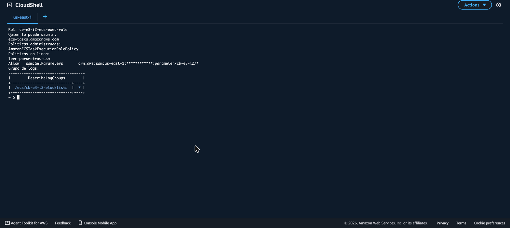

*Figura S4-01. Rol de ejecución, sus políticas y el grupo de logs, verificados desde CloudShell.*

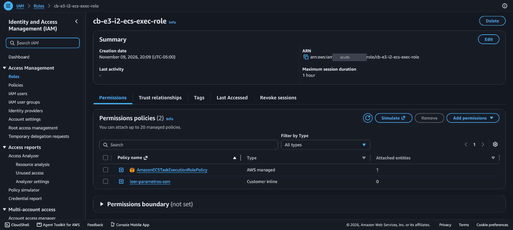

*Figura S4-02. Rol de ejecución en IAM con la política administrada y la política en línea de SSM.*

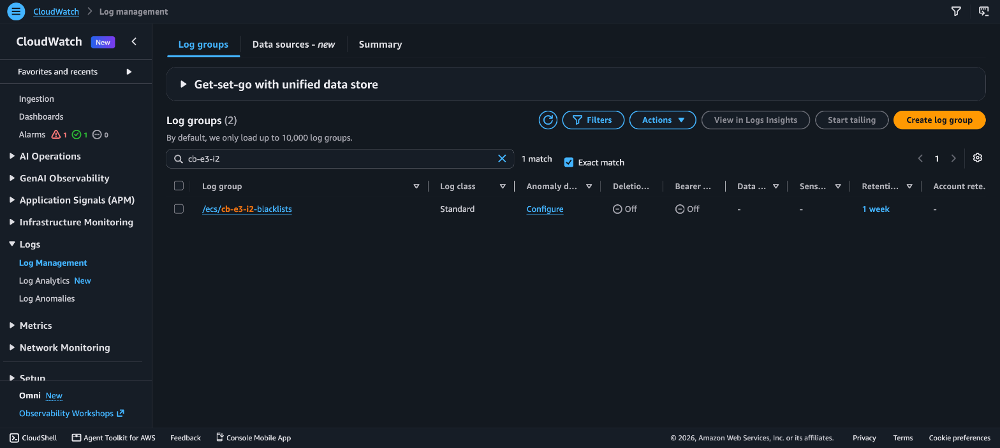

*Figura S4-03. Grupo de logs con retención de una semana.*

---

## 5. Base de datos RDS

```bash
aws rds create-db-subnet-group --db-subnet-group-name ${PREFIX}-db-subnets \
  --db-subnet-group-description "Subnets RDS Entrega 3" \
  --subnet-ids $SUBNET_A $SUBNET_B

DB_PASS=$(openssl rand -hex 16)   # solo letras y numeros; no se imprime

aws rds create-db-instance \
  --db-instance-identifier $DB_ID \
  --engine postgres --engine-version 16 \
  --db-instance-class db.t4g.micro \
  --allocated-storage 20 --storage-type gp3 \
  --master-username blacklists --master-user-password "$DB_PASS" \
  --db-name blacklists \
  --db-subnet-group-name ${PREFIX}-db-subnets \
  --vpc-security-group-ids $RDS_SG \
  --no-publicly-accessible --no-multi-az --storage-encrypted \
  --backup-retention-period 0 --no-deletion-protection

aws rds wait db-instance-available --db-instance-identifier $DB_ID   # 5 a 10 min

export DB_HOST=$(aws rds describe-db-instances --db-instance-identifier $DB_ID \
  --query 'DBInstances[0].Endpoint.Address' --output text)
```

En la validación la instancia tardó unos 5 minutos y RDS asignó PostgreSQL 16.13.

`--storage-encrypted` cifra el disco sin costo adicional. Hay que indicarlo al crear: no se puede activar después sobre la misma instancia.

**Ejecutar las secciones 5 y 6 seguidas, idealmente en un mismo script, y no cerrar la terminal entre ambas**: la contraseña solo existe en la variable `DB_PASS`. Si se pierde, se restablece con `aws rds modify-db-instance --master-user-password`.

Con respaldos en 0 no hay recuperación ante borrado. Es aceptable porque los datos son de prueba.

Evidencia: RDS disponible, con **Acceso público: No** y el security group asociado.

### Capturas de referencia

Ejemplo de la cuenta del Integrante 2. Los identificadores son de esa cuenta: no copiarlos.

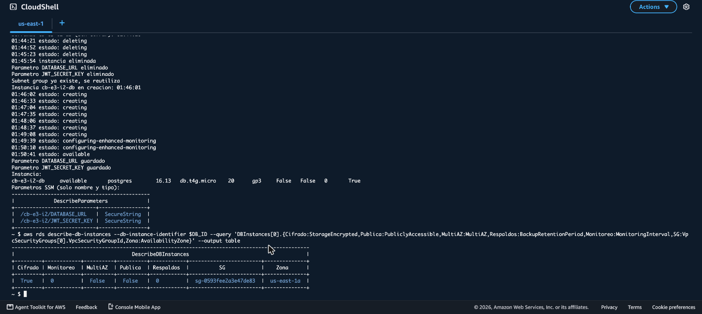

*Figura S5-01. Creación de la instancia, guardado de los secretos y verificación del cifrado. En esta cuenta la instancia se recreó para activar el cifrado, por eso aparece un borrado previo.*

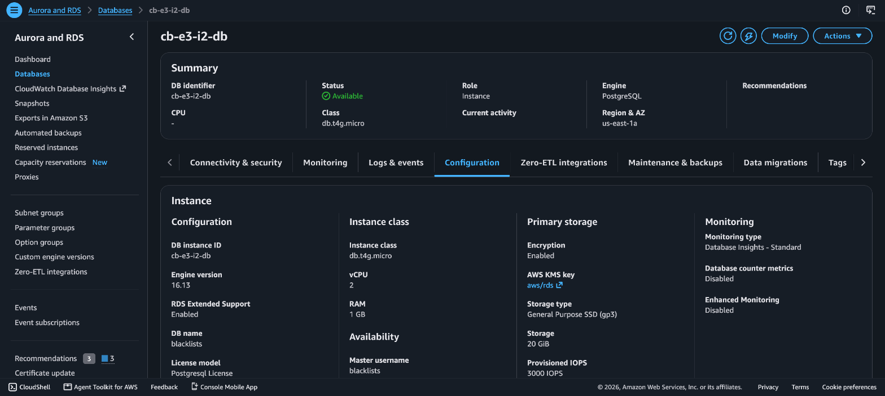

*Figura S5-02. Instancia disponible, con el cifrado habilitado.*

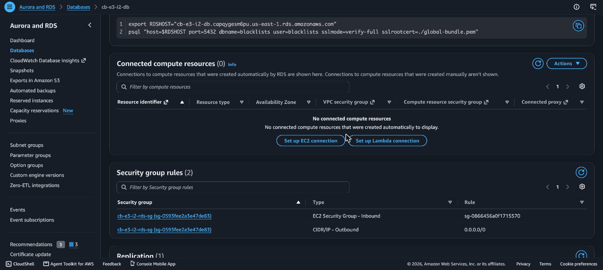

*Figura S5-03. Reglas del security group de la instancia: entrada solo desde el grupo de las tareas.*

---

## 6. Secretos en SSM Parameter Store

```bash
aws ssm put-parameter --name /${PREFIX}/DATABASE_URL --type SecureString \
  --value "postgresql://blacklists:${DB_PASS}@${DB_HOST}:5432/blacklists"

aws ssm put-parameter --name /${PREFIX}/JWT_SECRET_KEY --type SecureString \
  --value "$(openssl rand -hex 32)"

unset DB_PASS

export SSM_DB_ARN=arn:aws:ssm:${AWS_REGION}:${ACCOUNT_ID}:parameter/${PREFIX}/DATABASE_URL
export SSM_JWT_ARN=arn:aws:ssm:${AWS_REGION}:${ACCOUNT_ID}:parameter/${PREFIX}/JWT_SECRET_KEY
```

Los valores nunca van en la imagen, el repositorio, la task definition ni el informe. La task definition solo referencia el ARN del parámetro; ECS inyecta el valor al arrancar el contenedor.

### Capturas de referencia

Ejemplo de la cuenta del Integrante 2. Los identificadores son de esa cuenta: no copiarlos.

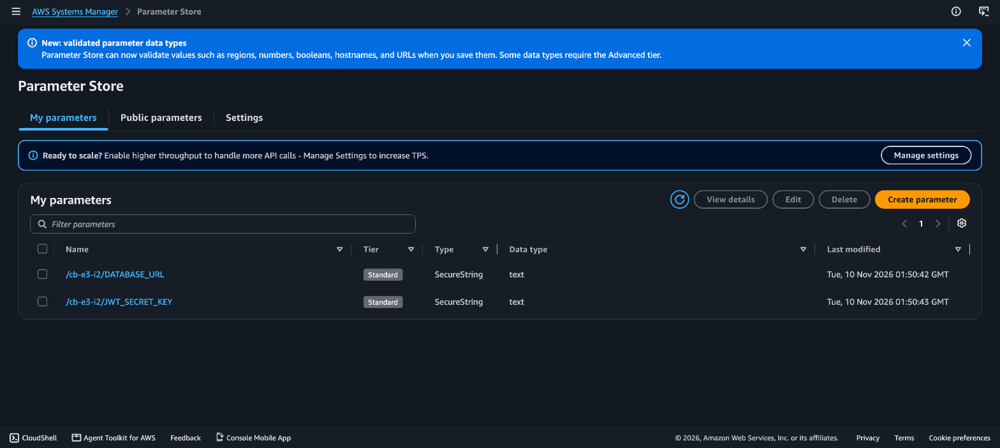

*Figura S6-01. Los dos parámetros `SecureString` en Parameter Store. La tabla no muestra los valores.*

---

## 7. Repositorio ECR e imagen inicial

**Opción recomendada: desde CloudShell.** Trae Docker, es x86_64 y ya está autenticado, así que la imagen sale en `linux/amd64` sin emulación:

```bash
aws ecr create-repository --repository-name $ECR_REPO > /dev/null

rm -rf /tmp/repo
git clone -q --depth 1 --branch main \
  https://github.com/OscarGomez-MISO/CodeBusters-DevOps.git /tmp/repo
cd /tmp/repo
export GIT_SHA=$(git rev-parse HEAD)

aws ecr get-login-password | docker login --username AWS --password-stdin \
  ${ACCOUNT_ID}.dkr.ecr.${AWS_REGION}.amazonaws.com

docker build --pull --platform linux/amd64 -t ${ECR_URI}:${GIT_SHA} .

docker image inspect ${ECR_URI}:${GIT_SHA} \
  --format '{{.Os}}/{{.Architecture}} usuario {{.Config.User}}'

docker push ${ECR_URI}:${GIT_SHA}
```

La inspección debe mostrar `linux/amd64` y usuario `10001:10001`. La salida de `docker push` incluye el ID de cuenta en la URL del registro: no capturarla, o agregar `-q > /dev/null`.

En la validación la construcción tardó 25 s y la publicación 16 s.

**Alternativa: desde la máquina local**, en la raíz del repositorio y sobre `main` actualizado. Cambian solo la obtención del código (ya está clonado) y el comando de construcción:

```bash
export GIT_SHA=$(git rev-parse HEAD)
docker buildx build --platform linux/amd64 -t ${ECR_URI}:${GIT_SHA} --push .
```

`--platform linux/amd64` es obligatorio en Mac con Apple Silicon. Sin él, la tarea falla al arrancar en Fargate con un error de formato de ejecutable.

La etiqueta es el SHA completo del commit, igual que hará el pipeline.

```bash
aws ecr describe-images --repository-name $ECR_REPO \
  --query 'imageDetails[0].[imageTags[0],imageDigest]' --output text
```

Registrar el SHA y el digest.

### Capturas de referencia

Ejemplo de la cuenta del Integrante 2. Los identificadores son de esa cuenta: no copiarlos.

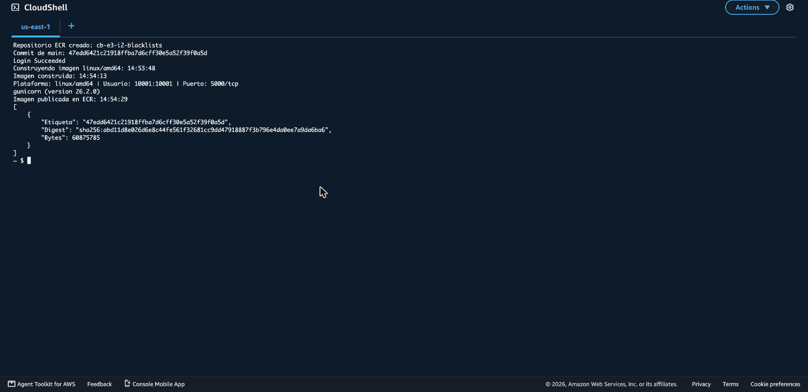

*Figura S7-01. Construcción, inspección y publicación de la imagen desde CloudShell, con el SHA del commit y el digest.*

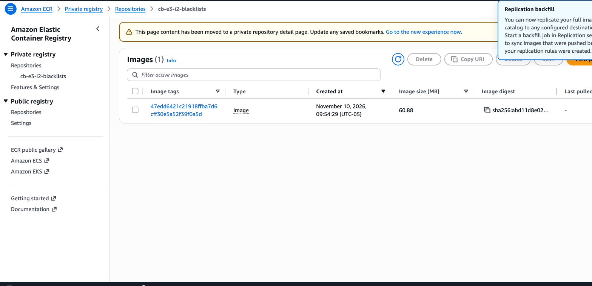

*Figura S7-02. Imagen en el repositorio de ECR, etiquetada con el SHA del commit.*

---

## 8. ALB, target groups y listener

```bash
export ALB_ARN=$(aws elbv2 create-load-balancer --name ${PREFIX}-alb \
  --type application --scheme internet-facing \
  --subnets $SUBNET_A $SUBNET_B --security-groups $ALB_SG \
  --query 'LoadBalancers[0].LoadBalancerArn' --output text)

crear_tg() {
  aws elbv2 create-target-group --name $1 \
    --protocol HTTP --port $CONTAINER_PORT --vpc-id $VPC_ID --target-type ip \
    --health-check-path /health --matcher HttpCode=200 \
    --health-check-interval-seconds 15 \
    --healthy-threshold-count 2 --unhealthy-threshold-count 3 \
    --query 'TargetGroups[0].TargetGroupArn' --output text
}

export TG_BLUE_ARN=$(crear_tg ${PREFIX}-tg-blue)
export TG_GREEN_ARN=$(crear_tg ${PREFIX}-tg-green)

for tg in $TG_BLUE_ARN $TG_GREEN_ARN; do
  aws elbv2 modify-target-group-attributes --target-group-arn $tg \
    --attributes Key=deregistration_delay.timeout_seconds,Value=30
done

export LISTENER_ARN=$(aws elbv2 create-listener --load-balancer-arn $ALB_ARN \
  --protocol HTTP --port 80 \
  --default-actions Type=forward,TargetGroupArn=$TG_BLUE_ARN \
  --query 'Listeners[0].ListenerArn' --output text)

export ALB_DNS=$(aws elbv2 describe-load-balancers --load-balancer-arns $ALB_ARN \
  --query 'LoadBalancers[0].DNSName' --output text)
```

Comprobar que el balanceador quedó activo y responde. Sin tareas registradas debe devolver **503**:

```bash
aws elbv2 wait load-balancer-available --load-balancer-arns $ALB_ARN
curl -s -o /dev/null -w 'HTTP %{http_code}\n' http://$ALB_DNS/health
```

En la validación tardó 1 min 51 s en quedar activo. Los ARN contienen el ID de cuenta: no mostrarlos en las capturas.

Los target groups son de tipo **IP** porque las tareas Fargate usan red `awsvpc`. El tipo instancia no funciona.

El listener apunta al grupo blue; el green queda sin asociar hasta el primer despliegue. Después de cada Blue/Green, CodeDeploy alterna el listener entre ambos.

Evidencia: Health check de un target group (`/health`, 200) y listener en el puerto 80.

### Capturas de referencia

Ejemplo de la cuenta del Integrante 2. Los identificadores son de esa cuenta: no copiarlos.

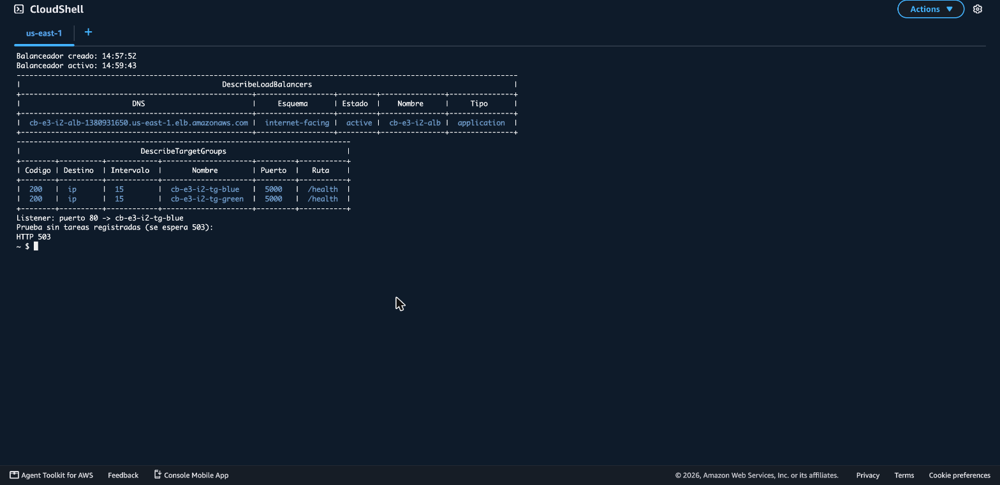

*Figura S8-01. Balanceador activo, los dos target groups con health check `/health`, el listener del puerto 80 y la prueba que responde 503 sin tareas.*

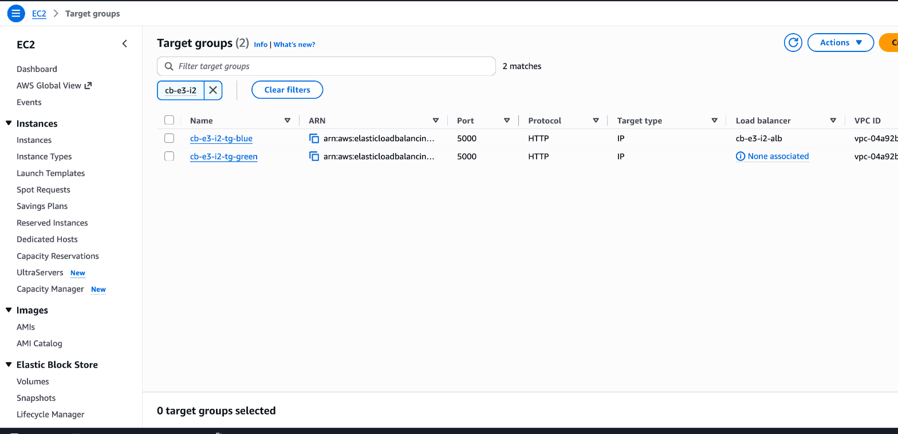

*Figura S8-02. Target groups de tipo IP en el puerto 5000; solo el blue está asociado al balanceador.*

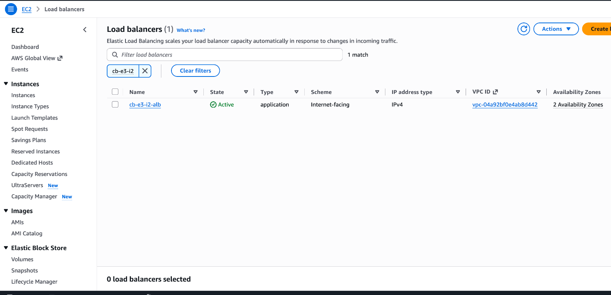

*Figura S8-03. Balanceador activo, expuesto a internet, en dos zonas.*

---

## 9. Cluster y task definition inicial

```bash
aws ecs create-cluster --cluster-name $CLUSTER

cat > /tmp/${PREFIX}-taskdef.json <<EOF
{
  "family": "${TASK_FAMILY}",
  "networkMode": "awsvpc",
  "requiresCompatibilities": ["FARGATE"],
  "cpu": "256",
  "memory": "512",
  "runtimePlatform": {
    "operatingSystemFamily": "LINUX",
    "cpuArchitecture": "X86_64"
  },
  "executionRoleArn": "${EXEC_ROLE_ARN}",
  "containerDefinitions": [
    {
      "name": "${CONTAINER_NAME}",
      "image": "${ECR_URI}:${GIT_SHA}",
      "essential": true,
      "portMappings": [
        {"containerPort": ${CONTAINER_PORT}, "protocol": "tcp"}
      ],
      "environment": [
        {"name": "TRUST_PROXY_HEADERS", "value": "true"},
        {"name": "PROXY_HOPS", "value": "1"}
      ],
      "secrets": [
        {"name": "DATABASE_URL", "valueFrom": "${SSM_DB_ARN}"},
        {"name": "JWT_SECRET_KEY", "valueFrom": "${SSM_JWT_ARN}"}
      ],
      "logConfiguration": {
        "logDriver": "awslogs",
        "options": {
          "awslogs-group": "${LOG_GROUP}",
          "awslogs-region": "${AWS_REGION}",
          "awslogs-stream-prefix": "ecs"
        }
      }
    }
  ]
}
EOF

export TASKDEF_ARN=$(aws ecs register-task-definition \
  --cli-input-json file:///tmp/${PREFIX}-taskdef.json \
  --query 'taskDefinition.taskDefinitionArn' --output text)
```

`PROXY_HOPS=1` corresponde a ALB directo a Gunicorn. No copiar el valor de dos proxies del despliegue Beanstalk con nginx.

El comando de arranque (`gunicorn --bind 0.0.0.0:5000 application:application`) viene del `Dockerfile`, no de la task definition.

`deploy/taskdef.template.json` debe conservar la misma estructura de este archivo, cambiando la imagen por `<IMAGE1_NAME>`.

### Capturas de referencia

Ejemplo de la cuenta del Integrante 2. Los identificadores son de esa cuenta: no copiarlos.

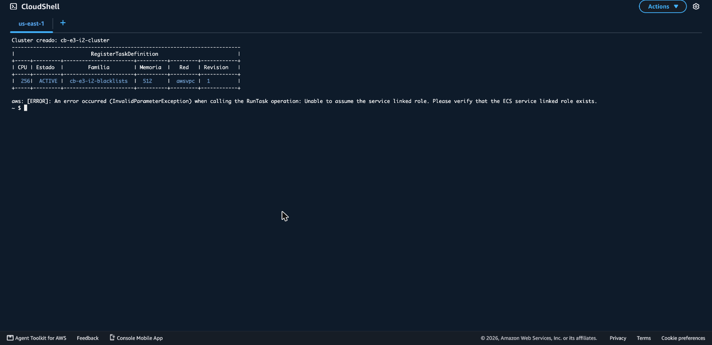

*Figura S9-01. Cluster creado y task definition registrada. El error final es el del rol vinculado al servicio, que se resuelve esperando un minuto (ver sección 10).*

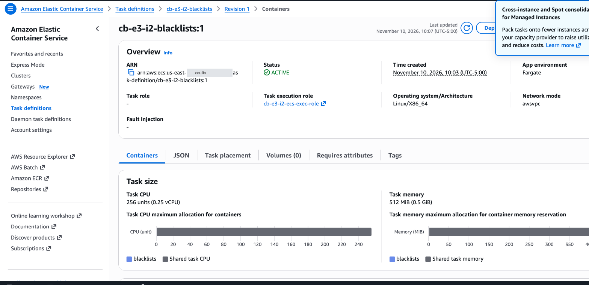

*Figura S9-02. Task definition en la consola: Fargate, Linux/X86_64, `awsvpc`, 0,25 vCPU y 512 MiB.*

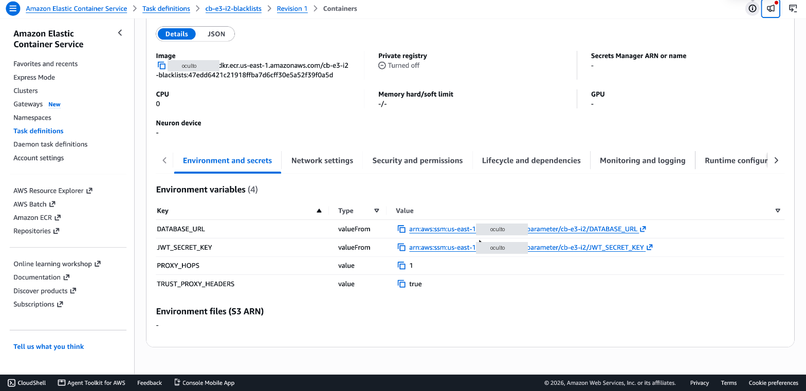

*Figura S9-03. Detalle del contenedor: `DATABASE_URL` y `JWT_SECRET_KEY` aparecen como `valueFrom` con el ARN del parámetro, no con su valor.*

---

## 10. Inicialización de tablas

> **Primera vez que la cuenta usa ECS.** Al crear el cluster, AWS crea solo el rol `AWSServiceRoleForECS`, y tarda cerca de un minuto en propagarse. Si `run-task` responde `Unable to assume the service linked role`, esperar un minuto y repetir el mismo comando sin cambios.

Tarea puntual que usa la misma imagen y los mismos secretos, pero reemplaza el comando. No hace falta definir `FLASK_APP`: el `Dockerfile` ya lo trae. Se ejecuta **una sola vez por base de datos**, antes de crear el servicio.

```bash
export NETCFG="awsvpcConfiguration={subnets=[$SUBNET_A,$SUBNET_B],securityGroups=[$TASK_SG],assignPublicIp=ENABLED}"

INIT_TASK=$(aws ecs run-task --cluster $CLUSTER --launch-type FARGATE \
  --task-definition $TASK_FAMILY --count 1 \
  --network-configuration "$NETCFG" \
  --overrides '{
    "containerOverrides": [{
      "name": "blacklists",
      "command": ["flask", "init-db"]
    }]
  }' \
  --query 'tasks[0].taskArn' --output text)

aws ecs wait tasks-stopped --cluster $CLUSTER --tasks $INIT_TASK

aws ecs describe-tasks --cluster $CLUSTER --tasks $INIT_TASK \
  --query 'tasks[0].containers[0].[exitCode,reason]' --output text

aws logs tail $LOG_GROUP --since 15m
```

El código de salida debe ser **0** y el log debe decir `Database tables ready.`. En la validación la tarea tardó 45 s.

| Síntoma | Causa probable |
| --- | --- |
| La tarea no arranca, `CannotPullContainerError` | Falta `assignPublicIp=ENABLED` o la subnet no es pública |
| `ResourceInitializationError ... ssm` | Permiso `ssm:GetParameters` del rol de ejecución, o nombre del parámetro |
| `exec format error` | Imagen construida sin `--platform linux/amd64` |
| Timeout de conexión a la base | Regla 5432 de `${PREFIX}-rds-sg` o security group de la tarea |
| `Unable to assume the service linked role` | Primera vez con ECS en la cuenta: esperar un minuto y repetir |
| `flask: command not found` o no encuentra la app | El `Dockerfile` cambió de `CMD` a `ENTRYPOINT` o de `WORKDIR`; en ese caso el override de `command` se agrega como argumento y hay que ajustar |

Evidencia: Tarea detenida con código de salida 0 y sus logs.

### Capturas de referencia

Ejemplo de la cuenta del Integrante 2. Los identificadores son de esa cuenta: no copiarlos.

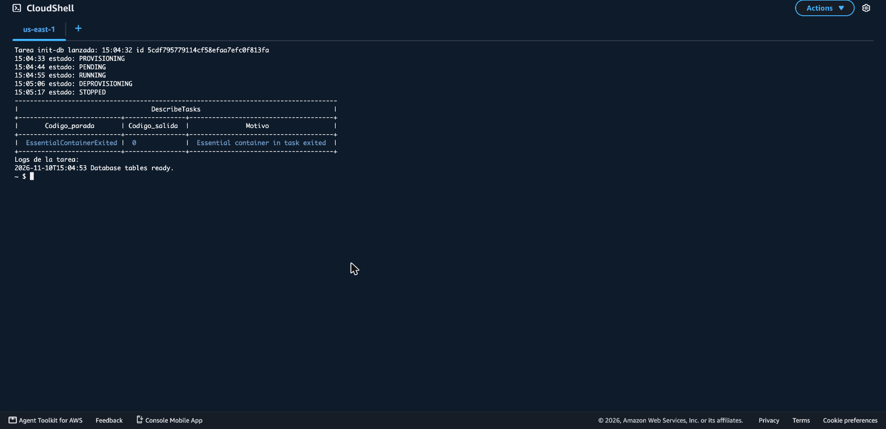

*Figura S10-01. Tarea `init-db`: ciclo de estados, código de salida 0 y log `Database tables ready.`*

---

## 11. Servicio ECS con controlador CODE_DEPLOY

```bash
aws ecs create-service --cluster $CLUSTER --service-name $SERVICE \
  --task-definition $TASK_FAMILY \
  --desired-count 1 --launch-type FARGATE --platform-version LATEST \
  --deployment-controller type=CODE_DEPLOY \
  --load-balancers "targetGroupArn=$TG_BLUE_ARN,containerName=$CONTAINER_NAME,containerPort=$CONTAINER_PORT" \
  --health-check-grace-period-seconds 60 \
  --network-configuration "$NETCFG"

aws ecs wait services-stable --cluster $CLUSTER --services $SERVICE
```

Puntos a tener presentes:

- El controlador `CODE_DEPLOY` se define al crear el servicio. Con él, las nuevas versiones **no** se despliegan con `aws ecs update-service`: pasan por CodeDeploy.
- Capacidad: una tarea de 0,25 vCPU y 512 MiB, sin autoescalado. Durante un Blue/Green hay temporalmente dos tareas (blue y green).
- Hasta que Juan David cree la aplicación y el grupo de CodeDeploy, el servicio simplemente corre la versión inicial.
- Recién creado, `runningCount` del servicio puede marcar 0 unos segundos aunque la tarea ya esté sana. Mirar el task set (`taskSets[0].runningCount` y `stabilityStatus`) o la salud del destino en el target group. En la validación el destino quedó sano en 35 s.

### Capturas de referencia

Ejemplo de la cuenta del Integrante 2. Los identificadores son de esa cuenta: no copiarlos.

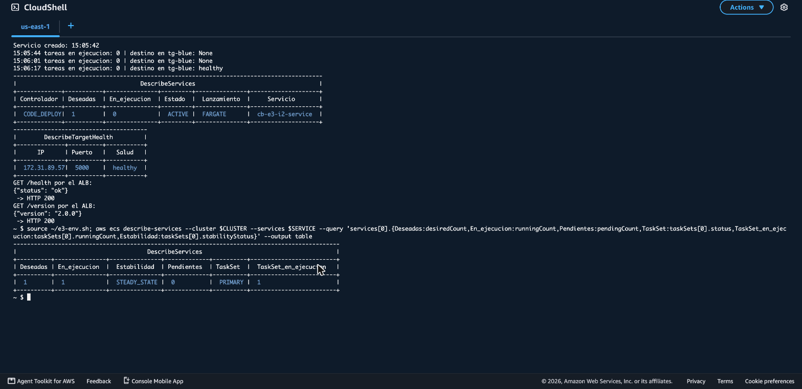

*Figura S11-01. Servicio creado, destino `healthy`, respuestas 200 de `/health` y `/version`, y conteo final 1 de 1.*

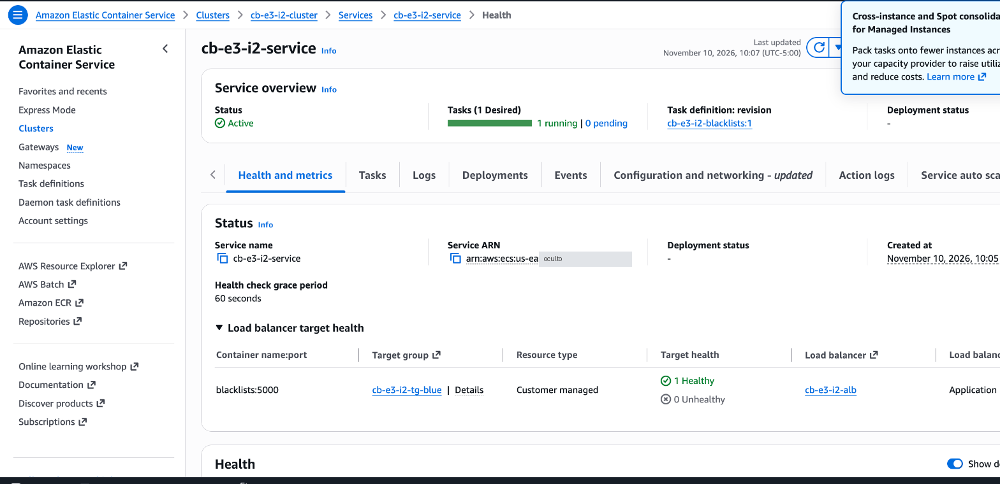

*Figura S11-02. Servicio activo en la consola, con 1 tarea en ejecución y 1 destino sano en el target group blue.*

---

## 12. Validación

### 12.1 Tareas saludables

```bash
aws ecs describe-services --cluster $CLUSTER --services $SERVICE \
  --query 'services[0].[status,desiredCount,runningCount]' --output text

aws elbv2 describe-target-health --target-group-arn $TG_BLUE_ARN \
  --query 'TargetHealthDescriptions[].[Target.Id,TargetHealth.State]' --output text

curl -i http://${ALB_DNS}/health
```

Esperado: `ACTIVE 1 1`, destino en `healthy` y respuesta `200`.

Si el destino queda en `unhealthy`: revisar `aws logs tail $LOG_GROUP --since 10m`, la regla 5000 de `${PREFIX}-task-sg` y que Gunicorn escuche en `0.0.0.0:5000`.

### 12.2 Token y colección Postman

El token es un JWT firmado con la `JWT_SECRET_KEY` del servicio. **Un token de otro ambiente (por ejemplo, el de Beanstalk de las entregas anteriores) no sirve**: está firmado con otra clave y la API responde 401. Los tokens de la app no vencen; lo único que importa es la clave con que se firmaron.

**Opción recomendada: desde CloudShell**, con la misma imagen que corre en Fargate. No requiere instalar nada:

```bash
source ~/e3-env.sh; source ~/e3-ids.sh

aws ecr get-login-password | docker login --username AWS --password-stdin \
  ${ACCOUNT_ID}.dkr.ecr.${AWS_REGION}.amazonaws.com

docker run --rm \
  -e DATABASE_URL="postgresql://x:x@localhost/x" \
  -e JWT_SECRET_KEY="$(aws ssm get-parameter --name /${PREFIX}/JWT_SECRET_KEY \
      --with-decryption --query Parameter.Value --output text)" \
  ${ECR_URI}:${GIT_SHA} flask generate-token

clear
```

La última línea que imprime, una cadena que empieza por `eyJ`, es el token. Copiarlo y ejecutar `clear` para que no quede en pantalla.

La `DATABASE_URL` es de relleno: el comando no se conecta a la base, pero la aplicación exige que la variable exista. Si `GIT_SHA` no está definido, tomar la etiqueta de la imagen en ECR.

**Alternativa: desde la máquina local**, con el entorno virtual del repositorio y el AWS CLI configurado:

```bash
source .venv/bin/activate
export FLASK_APP=application.py
export DATABASE_URL="postgresql://x:x@localhost/x"
export JWT_SECRET_KEY=$(aws ssm get-parameter --name /${PREFIX}/JWT_SECRET_KEY \
  --with-decryption --query Parameter.Value --output text)
flask generate-token
unset JWT_SECRET_KEY
```

El token no vence: tratarlo como una contraseña. No pegarlo en chats, en el repositorio ni en capturas.

Environment de Postman:

| Variable | Valor |
| --- | --- |
| `base_url` | `http://<ALB_DNS>` sin `/` final |
| `token` | Token generado, tipo **secret** |
| `app_uuid` | El UUID de pruebas del equipo |

Crear un environment nuevo para Fargate en lugar de modificar el de otro ambiente. Si todas las solicitudes responden 401, el token quedó mal copiado o está seleccionado otro environment.

Ejecutar la colección completa del equipo contra la URL del ALB y verificar los escenarios: health 200, agregar 201, consultar bloqueado 200, duplicado 409, ausente 200, UUID inválido 400 y sin token 401.

Evidencia: Servicio con 1/1 tareas, target group en `healthy`, resumen del Runner de Postman sin token visible.

### 12.3 Valores que se entregan a Fabio y a Juan David

```bash
echo "Cluster:            $CLUSTER"
echo "Servicio:           $SERVICE"
echo "Familia de tarea:   $TASK_FAMILY"
echo "Contenedor/puerto:  $CONTAINER_NAME / $CONTAINER_PORT"
echo "Rol de ejecucion:   $EXEC_ROLE_ARN"
echo "Repositorio ECR:    $ECR_URI"
echo "Grupo de logs:      $LOG_GROUP"
echo "Parametro DB:       $SSM_DB_ARN"
echo "Parametro JWT:      $SSM_JWT_ARN"
echo "Target group blue:  ${PREFIX}-tg-blue"
echo "Target group green: ${PREFIX}-tg-green"
echo "Listener prod:      $LISTENER_ARN"
echo "URL:                http://$ALB_DNS"
```

- **Fabio** necesita rol de ejecución, repositorio ECR, grupo de logs y los dos ARN de SSM para resolver `taskdef.json`. Son ARN, no secretos, pero contienen el ID de cuenta: van como variables de CodeBuild, no en la plantilla compartida.
- **Juan David** necesita cluster, servicio, nombres de los dos target groups y el ARN del listener para el grupo de despliegue de CodeDeploy.

### Capturas de referencia

Ejemplo de la cuenta del Integrante 2. Los identificadores son de esa cuenta: no copiarlos.

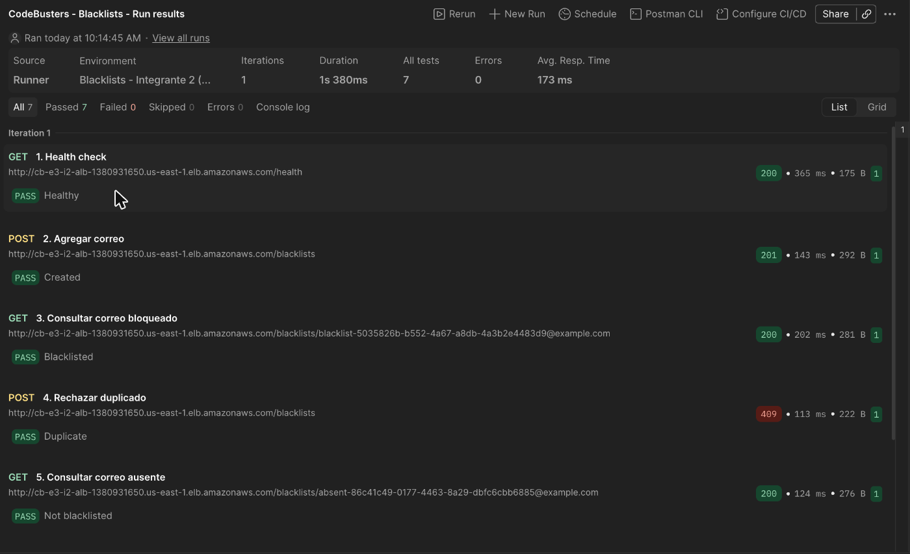

*Figura S12-01. Runner de Postman contra el ALB: 7 pruebas, 0 errores, y escenarios 1 a 5.*

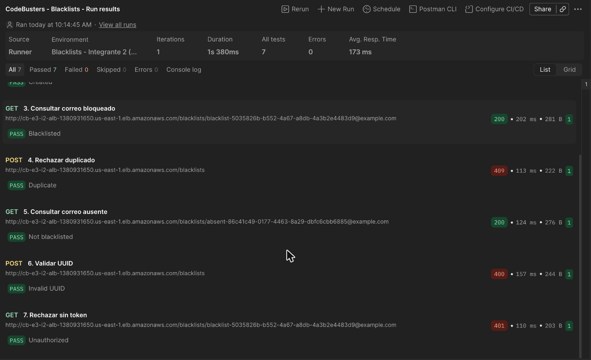

*Figura S12-02. Escenarios 3 a 7, incluidos el UUID inválido (400) y la solicitud sin token (401).*

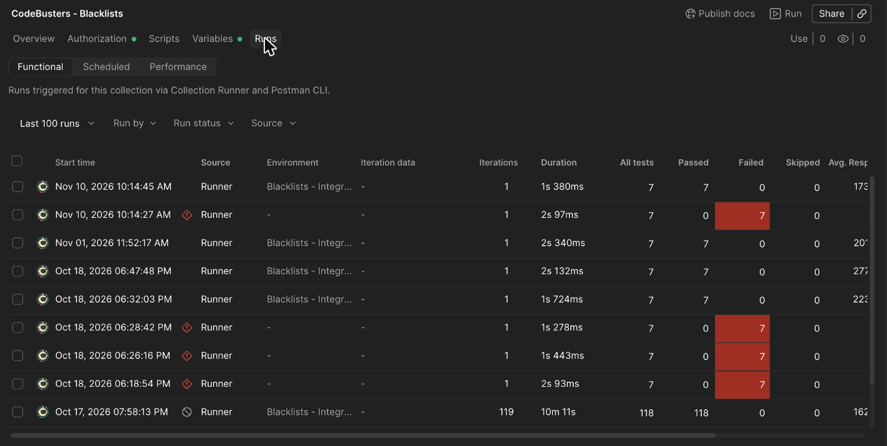

*Figura S12-03. Historial de ejecuciones de la colección.*

---

## 13. Costos mientras los recursos existan

Valores aproximados para `us-east-1`; verificar en la calculadora de AWS.

| Recurso | Cobro |
| --- | --- |
| ALB | Por hora, aunque no reciba tráfico. Es el recurso más costoso de esta guía |
| Tarea Fargate | Por vCPU y memoria por segundo mientras corre |
| RDS db.t4g.micro + 20 GB | Por hora y por GB. Puede entrar en capa gratuita según la cuenta |
| IP públicas (tarea y nodos del ALB) | Por hora cada una |
| ECR, CloudWatch Logs | Por GB almacenado; marginal en este proyecto |
| SSM Parameter Store estándar | Sin costo |

Para pausar sin borrar: `aws ecs update-service --cluster $CLUSTER --service $SERVICE --desired-count 0` detiene Fargate, y `aws rds stop-db-instance --db-instance-identifier $DB_ID` detiene RDS hasta por siete días. El ALB sigue cobrando.

---

## 14. Eliminación de los recursos de esta guía

Ejecutar solo cuando termine el periodo de evaluación y las evidencias estén guardadas. Si la terminal es nueva, cargar antes las variables de la sección 2.2 y el Anexo A.

**Antes:** eliminar el pipeline y el grupo y la aplicación de CodeDeploy con la guía de Juan David, para que nada vuelva a crear tareas.

```bash
# 1. Servicio, tareas y cluster
aws ecs update-service --cluster $CLUSTER --service $SERVICE --desired-count 0
aws ecs delete-service --cluster $CLUSTER --service $SERVICE --force
aws ecs wait services-inactive --cluster $CLUSTER --services $SERVICE
aws ecs list-tasks --cluster $CLUSTER --query taskArns --output text   # debe salir vacio

for td in $(aws ecs list-task-definitions --family-prefix $TASK_FAMILY \
    --query taskDefinitionArns --output text); do
  aws ecs deregister-task-definition --task-definition $td > /dev/null
done

aws ecs delete-cluster --cluster $CLUSTER

# 2. ALB (elimina sus listeners) y target groups
aws elbv2 delete-load-balancer --load-balancer-arn $ALB_ARN
aws elbv2 wait load-balancers-deleted --load-balancer-arns $ALB_ARN
aws elbv2 delete-target-group --target-group-arn $TG_BLUE_ARN
aws elbv2 delete-target-group --target-group-arn $TG_GREEN_ARN

# 3. RDS: SE PIERDEN LOS DATOS, sin snapshot final
aws rds delete-db-instance --db-instance-identifier $DB_ID \
  --skip-final-snapshot --delete-automated-backups
aws rds wait db-instance-deleted --db-instance-identifier $DB_ID
aws rds delete-db-subnet-group --db-subnet-group-name ${PREFIX}-db-subnets

# 4. ECR (incluye las imagenes publicadas por el pipeline), logs y parametros
aws ecr delete-repository --repository-name $ECR_REPO --force
aws logs delete-log-group --log-group-name $LOG_GROUP
aws ssm delete-parameter --name /${PREFIX}/DATABASE_URL
aws ssm delete-parameter --name /${PREFIX}/JWT_SECRET_KEY

# 5. Rol de ejecucion
aws iam detach-role-policy --role-name $EXEC_ROLE \
  --policy-arn arn:aws:iam::aws:policy/service-role/AmazonECSTaskExecutionRolePolicy
aws iam delete-role-policy --role-name $EXEC_ROLE --policy-name leer-parametros-ssm
aws iam delete-role --role-name $EXEC_ROLE

# 6. Security groups, en este orden por sus dependencias
aws ec2 delete-security-group --group-id $RDS_SG
aws ec2 delete-security-group --group-id $TASK_SG
aws ec2 delete-security-group --group-id $ALB_SG
```

Si un security group responde `DependencyViolation`, aún queda una interfaz de red del ALB o de una tarea liberándose. Esperar un par de minutos y repetir.

No se elimina la VPC por defecto ni sus subnets: no las creó esta guía y pueden usarlas otros trabajos.

### Verificación final

```bash
aws ecs list-clusters --query clusterArns --output text
aws elbv2 describe-load-balancers --query "LoadBalancers[?starts_with(LoadBalancerName,'${PREFIX}')].LoadBalancerName" --output text
aws elbv2 describe-target-groups --query "TargetGroups[?starts_with(TargetGroupName,'${PREFIX}')].TargetGroupName" --output text
aws rds describe-db-instances --query "DBInstances[?starts_with(DBInstanceIdentifier,'${PREFIX}')].DBInstanceIdentifier" --output text
aws rds describe-db-snapshots --query "DBSnapshots[?starts_with(DBInstanceIdentifier,'${PREFIX}')].DBSnapshotIdentifier" --output text
aws ecr describe-repositories --query "repositories[?starts_with(repositoryName,'${PREFIX}')].repositoryName" --output text
aws ec2 describe-security-groups --filters Name=group-name,Values="${PREFIX}-*" --query 'SecurityGroups[].GroupName' --output text
aws ssm describe-parameters --parameter-filters Key=Name,Option=BeginsWith,Values=/${PREFIX}/ --query 'Parameters[].Name' --output text
```

Todos deben salir vacíos, salvo recursos de otros trabajos en la cuenta. Revisar la facturación uno o dos días después; la información de costos llega con retraso.

Puede seguir cobrando si se omite: snapshots manuales de RDS, imágenes en ECR y logs de CloudWatch.

---

## Anexo A. Recuperar identificadores en una terminal nueva

Después de ejecutar el bloque de la sección 2.2:

```bash
export VPC_ID=$(aws ec2 describe-vpcs --filters Name=is-default,Values=true --query 'Vpcs[0].VpcId' --output text)
export SUBNET_A=$(aws ec2 describe-subnets --filters Name=vpc-id,Values=$VPC_ID Name=availability-zone,Values=us-east-1a --query 'Subnets[0].SubnetId' --output text)
export SUBNET_B=$(aws ec2 describe-subnets --filters Name=vpc-id,Values=$VPC_ID Name=availability-zone,Values=us-east-1b --query 'Subnets[0].SubnetId' --output text)

sg_id() { aws ec2 describe-security-groups --filters Name=group-name,Values=$1 Name=vpc-id,Values=$VPC_ID --query 'SecurityGroups[0].GroupId' --output text; }
export ALB_SG=$(sg_id ${PREFIX}-alb-sg)
export TASK_SG=$(sg_id ${PREFIX}-task-sg)
export RDS_SG=$(sg_id ${PREFIX}-rds-sg)

export EXEC_ROLE_ARN=arn:aws:iam::${ACCOUNT_ID}:role/${EXEC_ROLE}
export SSM_DB_ARN=arn:aws:ssm:${AWS_REGION}:${ACCOUNT_ID}:parameter/${PREFIX}/DATABASE_URL
export SSM_JWT_ARN=arn:aws:ssm:${AWS_REGION}:${ACCOUNT_ID}:parameter/${PREFIX}/JWT_SECRET_KEY

export ALB_ARN=$(aws elbv2 describe-load-balancers --names ${PREFIX}-alb --query 'LoadBalancers[0].LoadBalancerArn' --output text)
export ALB_DNS=$(aws elbv2 describe-load-balancers --names ${PREFIX}-alb --query 'LoadBalancers[0].DNSName' --output text)
export TG_BLUE_ARN=$(aws elbv2 describe-target-groups --names ${PREFIX}-tg-blue --query 'TargetGroups[0].TargetGroupArn' --output text)
export TG_GREEN_ARN=$(aws elbv2 describe-target-groups --names ${PREFIX}-tg-green --query 'TargetGroups[0].TargetGroupArn' --output text)
export LISTENER_ARN=$(aws elbv2 describe-listeners --load-balancer-arn $ALB_ARN --query 'Listeners[0].ListenerArn' --output text)

export NETCFG="awsvpcConfiguration={subnets=[$SUBNET_A,$SUBNET_B],securityGroups=[$TASK_SG],assignPublicIp=ENABLED}"
```

## Anexo B. Lista de capturas

Evidencias que cada integrante toma en su cuenta. Convención de nombre: `S<sección>-<orden>-<descripción>.png`.

| Captura | Sección | Qué muestra |
| --- | --- | --- |
| `S2-01` | 2 | Parámetros cargados en CloudShell; la cuenta se muestra solo con sus últimos cuatro dígitos. |
| `S3-01` | 3 | VPC por defecto, subnets públicas, security groups creados y sus reglas de entrada. |
| `S3-02` | 3 | Security group de las tareas: entrada TCP 5000 solo desde el grupo del ALB. |
| `S3-03` | 3 | Security group de RDS: entrada PostgreSQL 5432 solo desde el grupo de las tareas. |
| `S3-04` | 3 | Security group del ALB: entrada HTTP 80 desde internet. |
| `S4-01` | 4 | Rol de ejecución, sus políticas y el grupo de logs, verificados desde CloudShell. |
| `S4-02` | 4 | Rol de ejecución en IAM con la política administrada y la política en línea de SSM. |
| `S4-03` | 4 | Grupo de logs con retención de una semana. |
| `S5-01` | 5 | Creación de la instancia, guardado de los secretos y verificación del cifrado. En esta cuenta la instancia se recreó para activar el cifrado, por eso aparece un borrado previo. |
| `S5-02` | 5 | Instancia disponible, con el cifrado habilitado. |
| `S5-03` | 5 | Reglas del security group de la instancia: entrada solo desde el grupo de las tareas. |
| `S6-01` | 6 | Los dos parámetros `SecureString` en Parameter Store. La tabla no muestra los valores. |
| `S7-01` | 7 | Construcción, inspección y publicación de la imagen desde CloudShell, con el SHA del commit y el digest. |
| `S7-02` | 7 | Imagen en el repositorio de ECR, etiquetada con el SHA del commit. |
| `S8-01` | 8 | Balanceador activo, los dos target groups con health check `/health`, el listener del puerto 80 y la prueba que responde 503 sin tareas. |
| `S8-02` | 8 | Target groups de tipo IP en el puerto 5000; solo el blue está asociado al balanceador. |
| `S8-03` | 8 | Balanceador activo, expuesto a internet, en dos zonas. |
| `S9-01` | 9 | Cluster creado y task definition registrada. El error final es el del rol vinculado al servicio, que se resuelve esperando un minuto (ver sección 10). |
| `S9-02` | 9 | Task definition en la consola: Fargate, Linux/X86_64, `awsvpc`, 0,25 vCPU y 512 MiB. |
| `S9-03` | 9 | Detalle del contenedor: `DATABASE_URL` y `JWT_SECRET_KEY` aparecen como `valueFrom` con el ARN del parámetro, no con su valor. |
| `S10-01` | 10 | Tarea `init-db`: ciclo de estados, código de salida 0 y log `Database tables ready.` |
| `S11-01` | 11 | Servicio creado, destino `healthy`, respuestas 200 de `/health` y `/version`, y conteo final 1 de 1. |
| `S11-02` | 11 | Servicio activo en la consola, con 1 tarea en ejecución y 1 destino sano en el target group blue. |
| `S12-01` | 12 | Runner de Postman contra el ALB: 7 pruebas, 0 errores, y escenarios 1 a 5. |
| `S12-02` | 12 | Escenarios 3 a 7, incluidos el UUID inválido (400) y la solicitud sin token (401). |
| `S12-03` | 12 | Historial de ejecuciones de la colección. |

Mínimo indispensable para el informe: reglas de los security groups de tareas y RDS, RDS disponible sin acceso público, parámetros SSM sin valores, imagen con SHA y digest, target group sano, secretos referenciados por ARN, `init-db` con código 0, servicio 1 de 1 con controlador CodeDeploy y Runner de Postman.

Cuidados al capturar:

- La consola muestra el ID de cuenta arriba a la derecha y dentro de los ARN (rol, task definition, servicio, URI de la imagen). Recortar el encabezado y tapar los ARN.
- No capturar valores de secretos ni el token de Postman.
- No abrir el menú de la cuenta.
